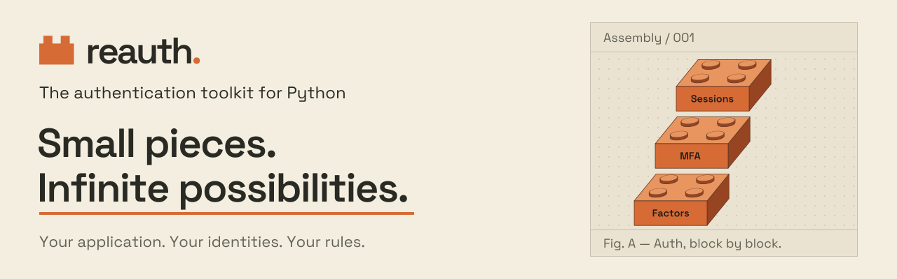

<h1><a href="https://frankie567.github.io/reauth/">
  <picture>
    <source media="(prefers-color-scheme: dark)" srcset="https://raw.githubusercontent.com/frankie567/reauth/main/brand/readme-header-dark.svg">
    
  </picture>
</a></h1>

<p align="center">
  <strong><a href="https://frankie567.github.io/reauth/">Documentation</a></strong> ·
  <strong><a href="https://frankie567.github.io/reauth/getting-started/">Getting started</a></strong> ·
  <strong><a href="https://github.com/frankie567/reauth">Source code</a></strong>
</p>

<p align="center">
  <a href="https://github.com/frankie567/reauth/actions"></a>
  <a href="https://codecov.io/gh/frankie567/reauth"></a>
  <a href="https://badge.fury.io/py/reauth"></a>
  <a href="https://www.bestpractices.dev/projects/14975"></a>
</p>

> [!WARNING]
> This is an early-stage project with many moving parts and mostly missing documentation. The API is not yet stable and breaking changes are expected.

## Roadmap

Our vision is to build a comprehensive, flexible authentication toolkit for Python that handles everything from low-level factor primitives to high-level OIDC server capabilities.

### Short-term: Core Foundation

- [ ] Factor primitives — building blocks for authentication factors
    - [x] Email OTP
    - [x] HOTP
    - [x] TOTP
    - [ ] Passwords
    - [ ] Security keys
    - [ ] Passkeys
    - [x] Social Login
- [x] MFA authentication management — multi-factor authentication workflows

### Mid-term: Integration Layer

- [x] Sessions management — robust session handling
- [ ] ORM and web frameworks wrappers — seamless integration with popular frameworks

### Long-term: Full Platform

- [ ] OIDC server — complete OpenID Connect provider implementation
- [ ] Team management — multi-user and organizational features
- [ ] And more — expanding the ecosystem

## Development

### Setup environment

We use [uv](https://docs.astral.sh/uv/) to manage the development environment and production build, and [just](https://github.com/casey/just) to manage command shortcuts. Ensure they are installed on your system.

Run `just install` to install the development dependencies and pre-commit hooks.

### Run unit tests

You can run all the tests with:

```bash
just test
```

By default, tests run against an in-memory SQLite database. To run tests against other DBMS, PostgreSQL and MySQL, you'll need a Docker installation. Then, run the tests with:

```bash
just test-db
```

### Format the code

Execute the following command to apply linting and check typing:

```bash
just lint
```

### Publishing a release

1. Commit the release entries under `Unreleased` in [CHANGELOG.md](CHANGELOG.md).
   From a clean release branch with Git signing configured, run `just version patch`,
   `just version minor`, or `just version major`. The recipe updates the version,
   changelog, and lockfile and creates a signed commit.
2. Preview the release body with `just release-notes <version>`, then push the branch
   and merge the release PR into `main`.
3. With the GitHub CLI authenticated, run `just release <PR number>`. This signs and
   pushes a tag for the exact commit that landed, even if `main` has advanced.
   After the checks pass, CI publishes to PyPI and then publishes the GitHub release.

The PyPI Trusted Publisher must match `build.yml` and the GitHub `release` environment.

## Serve the documentation

The documentation and landing page use [Zensical](https://zensical.org/).
Start the local preview with:

```bash
just docs-serve
```

Open http://localhost:8000. The preview reloads when documentation changes.
Edit pages in `docs/` and configure the site in `zensical.toml`.

Build the static site into `site/` with:

```bash
just docs-build
```

## License

This project is licensed under the terms of the MIT license.
